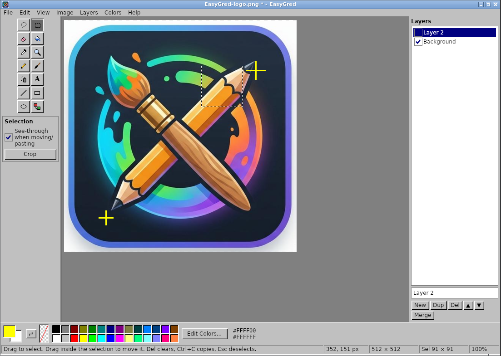

<p align="center">
  
</p>

# EasyGred — Easy Graphix Edit

A small, portable picture editor for **Windows and Linux**, inspired by the simple late-90s paint programs.
Written from scratch (clean room) in C# / .NET 8 with [Avalonia UI](https://avaloniaui.net/) and SkiaSharp.

**[Download the latest release](https://github.com/HermanRas/EasyGred/releases/latest)** — unzip and run, nothing to install.



## Features

- **Files:** open BMP, PNG, JPG, WebP (and GIF, first frame). Save as BMP, PNG, JPG, WebP.
  - BMP keeps transparency (32-bit) and is 24-bit when the picture is fully opaque.
  - JPG asks for quality; transparent areas become white.
  - WebP: lossless (default) or lossy with quality. *File → Export Copy as WebP* saves a copy without changing the open file.
- **Tools:** free-form select, rectangle select, eraser (to transparent), fill (with tolerance, contiguous or global),
  pick color, magnifier, pencil, brush, airbrush, text, line, rectangle, ellipse, color replace.
- **Colors:** 28-color palette plus a transparent swatch; primary (left click) and secondary (right click) colors;
  double-click a swatch to redefine it. *Edit Colors* opens a picker with a spectrum, RGB + **alpha** sliders and **hex** (`#RRGGBB` / `#RRGGBBAA`).
- **Transparency:** set any color's alpha in the picker; *Image → Make Color Transparent* (Ctrl+T) turns every pixel of a color transparent.
- **Bulk color replace:** *Image → Replace Color* (Ctrl+H) with tolerance; limited to the selection when there is one. The color replace tool does the same with one click.
- **Image:** crop to selection, flip, rotate 90°/180° (whole image or just the selection), resize canvas or scale picture (crisp or smooth), clear.
- **Selections:** move, delete, cut/copy/paste (also to/from other apps as PNG), paste from file, see-through or opaque.
- **Layers (optional):** hidden by default (Ctrl+L). Add, duplicate, delete, reorder, hide, merge, flatten. Saving merges visible layers into the file.
- Unlimited-ish undo/redo (50 steps / 400 MB), zoom 12.5 %–3200 % with pixel grid, drag & drop files onto the window.

Press **F1** in the app for all keyboard shortcuts.

## Portable builds

Builds are self-contained: no .NET install, no installer, no registry, no settings files. Unzip and run.

| Platform | Run |
|---|---|
| Windows x64 | `EasyGred-<ver>-win-x64\EasyGred.exe` |
| Linux x64 | `EasyGred-<ver>-linux-x64/EasyGred` (or `easygred.sh`) |

### Installing on Linux (optional)

To add EasyGred to the application menu (Linux Mint, Ubuntu, etc.) and get an `easygred` command, run the installer from the unzipped folder:

```bash
./install.sh                  # just you, no sudo: ~/.local/opt/easygred + menu entry
sudo ./install.sh --system    # all users: /opt/easygred, /usr/local/bin/easygred
./install.sh --uninstall      # remove again (add --system for a system-wide install)
```

EasyGred then appears under **Graphics** in the menu and in "Open With" for PNG, BMP, JPG and WebP files.

## Building

Everything builds inside Docker, so nothing needs to be installed on the host.

```bash
./build.sh            # Windows + Linux portable builds -> dist/*.zip
./build.sh linux      # Linux only
./build.sh windows    # Windows only
./build.sh test       # unit tests
```

The first run creates the `easygred-build` image from `docker/build.Dockerfile` (.NET 8 SDK + fontconfig, plus Xvfb tools
for headless UI checks). NuGet packages are cached in the Docker volume `easygred-nuget`.

With a local .NET 8 SDK (e.g. Visual Studio on Windows) you can also just run `dotnet run --project src/EasyGred`.

## Layout

```
src/EasyGred.Core/     pixel engine, no UI: document/layers/undo, drawing & fill algorithms,
                       selections, image load/save (Skia + own BMP writer), text rendering
src/EasyGred/          Avalonia desktop app
  Controls/            CanvasView (rendering + tools + edit commands), Swatch, tool icons
  Dialogs/             color picker, replace color, new/resize image, save quality, message box
  Styles/Retro.axaml   the gray bevelled look
  Assets/              app icon (.ico for Windows, PNG sizes for Linux)
tests/EasyGred.Tests/  xUnit tests for the core engine
packaging/linux/       launcher + install.sh (menu entry, icons) shipped with the Linux build
art/                   source artwork for the icon (not shipped)
docs/                  README screenshot
```

## Clean-room note

EasyGred contains no code, icons or assets from GraphicsGale, Microsoft Paint or any other editor.
The feature set comes from general knowledge of how simple paint programs behave; all icons are original vector drawings and
the app icon is the project's own artwork.
